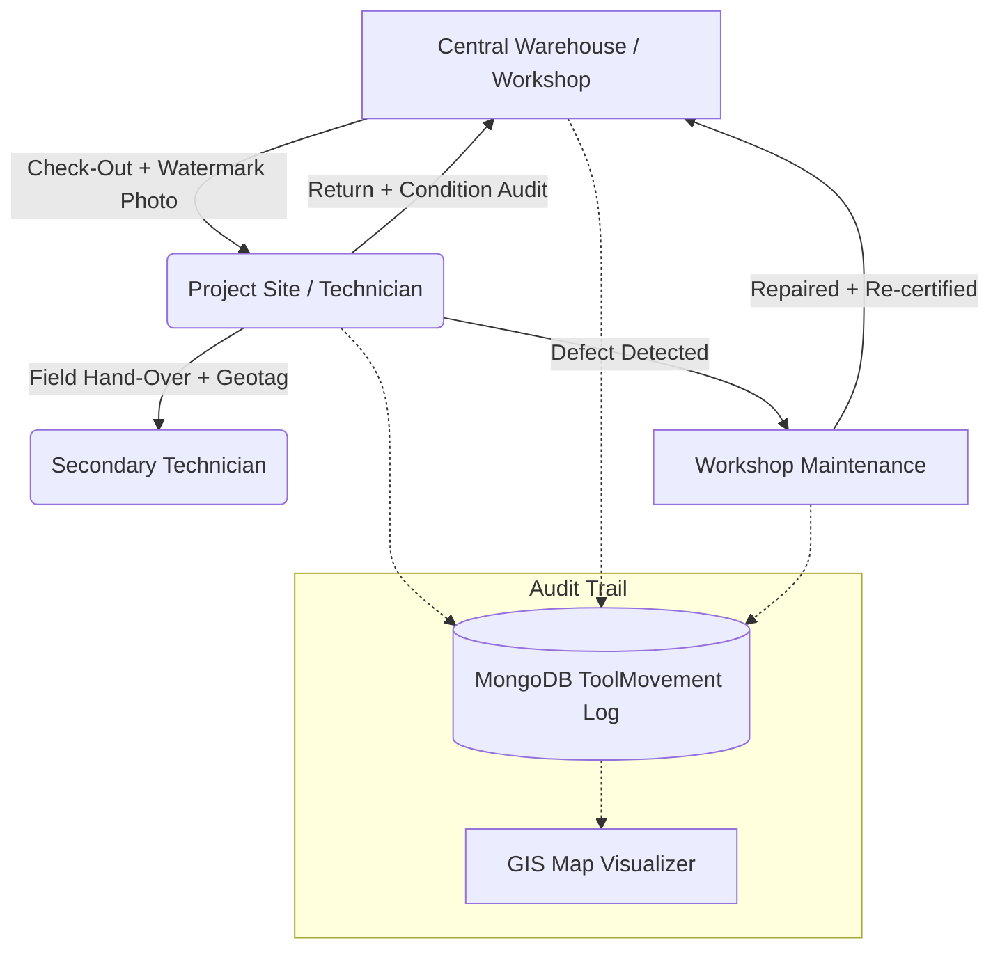

# 🛠️ MTERP — Tools & Equipment Management (Inventaris Alat)
## Comprehensive Technical & Operational Field Manual

> **Module Version:** v2.4 (Enterprise Edition)  
> **Applicable Stack:** React 19 (Frontend) | Node.js Express & MongoDB (Backend) | Leaflet GIS | HTML5 Geotagged Watermark Engine  
> **Target Audience:** Asset Managers, Site Engineers, Warehouse Superintendents, Supervisors, Foremen, and System Administrators  

---

## 📑 Table of Contents

1. [Executive Summary & Business Value](#1-executive-summary--business-value)
2. [Architecture & Technical Component Map](#2-architecture--technical-component-map)
3. [Role-Based Access Control (RBAC) Matrix](#3-role-based-access-control-rbac-matrix)
4. [Facility & Warehouse Management Setup](#4-facility--warehouse-management-setup)
5. [Tool Registration & Ingestion Workflows](#5-tool-registration--ingestion-workflows)
   - [5.1 Single Tool Registration](#51-single-tool-registration)
   - [5.2 Bulk Excel Import (.xlsx) with Interactive Validation](#52-bulk-excel-import-xlsx-with-interactive-validation)
   - [5.3 Data Export (.xlsx)](#53-data-export-xlsx)
6. [ERP Grid Navigation, Grouping, & Dense Views](#6-erp-grid-navigation-grouping--dense-views)
   - [6.1 Multi-Tier Grouping](#61-multi-tier-grouping)
   - [6.2 Table Density Toggles](#62-table-density-toggles)
   - [6.3 View Mode: Table vs. Card (Mobile-Optimized)](#63-view-mode-table-vs-card-mobile-optimized)
   - [6.4 Quick Filters & Metric Donut Chart](#64-quick-filters--metric-donut-chart)
7. [Batch Selection & Bulk Operations](#7-batch-selection--bulk-operations)
8. [The 8 Custody & Movement Workflows](#8-the-8-custody--movement-workflows)
   - [8.1 Workflow Matrix](#81-workflow-matrix)
   - [8.2 Step-by-Step Movement Execution](#82-step-by-step-movement-execution)
9. [Anti-Fraud Geotagged Watermark Camera Engine](#9-anti-fraud-geotagged-watermark-camera-engine)
   - [9.1 Hardware Access & GPS High-Accuracy Locking](#91-hardware-access--gps-high-accuracy-locking)
   - [9.2 Client-Side Canvas Watermark Burning](#92-client-side-canvas-watermark-burning)
   - [9.3 Storage Retention & Photo Purging Policy](#93-storage-retention--photo-purging-policy)
10. [Interactive GIS Geofence & Warehouse Visualizer](#10-interactive-gis-geofence--warehouse-visualizer)
11. [Field Technician Self-Service ("Alat Saya")](#11-field-technician-self-service-alat-saya)
12. [Movement Audit Trail & Photographic Evidence Drawer](#12-movement-audit-trail--photographic-evidence-drawer)
13. [Troubleshooting & Field Best Practices](#13-troubleshooting--field-best-practices)

---

## 1. Executive Summary & Business Value

Construction tool and equipment shrinkage is one of the highest unaccounted cost drivers in commercial contracting. Heavy plant, survey gear (total stations, theodolites), power tools, and pneumatic equipment frequently suffer from:
- **Phantom Tool Losses:** Unrecorded transfers between project sites leading to tools disappearing off company balance sheets.
- **Custody Disputes:** Subcontractors or workers denying custody of damaged or unreturned tools.
- **Maintenance Blindspots:** Tools remaining tagged as "active" despite needing service, resulting in project schedule slippage.
- **Warehouse Drift:** Zero visibility into specific rack bins or physical warehouse coordinates.

**MTERP Tools & Equipment Management** provides complete lifecycle visibility. Every movement requires cryptographic or physical verification—combining **real-time camera capture**, **GPS coordinates**, **timestamping**, and **operator accountability** burned directly into visual evidence.



---

## 2. Architecture & Technical Component Map

The Tools module spans frontend interactive UI layers, canvas graphics processing, and MongoDB models:

### 2.1 Frontend Components (`mterp-web/src/components/tools/`)
- [`Tools.tsx`](file:///c:/Users/CorSec/Documents/personal/MTERPweb/mterp-web/src/pages/Tools.tsx): Main ERP orchestrator, KPI summary cards, multi-tier grouped tables, mobile reflow cards, and floating bulk action bar.
- [`ToolsMapView.tsx`](file:///c:/Users/CorSec/Documents/personal/MTERPweb/mterp-web/src/components/tools/ToolsMapView.tsx): High-performance Leaflet GIS map with OpenStreetMap & Esri satellite layer switching, warehouse markers, and geofence indicators.
- [`ToolMovementModal.tsx`](file:///c:/Users/CorSec/Documents/personal/MTERPweb/mterp-web/src/components/tools/ToolMovementModal.tsx): Custody dispatcher supporting 8 distinct movement types, destination selectors, and evidence linking.
- [`CaptureWatermarkModal.tsx`](file:///c:/Users/CorSec/Documents/personal/MTERPweb/mterp-web/src/components/tools/CaptureWatermarkModal.tsx): Embedded HTML5 camera modal with GPS accuracy meter and client-side canvas watermark burner.
- [`ToolMovementsDrawer.tsx`](file:///c:/Users/CorSec/Documents/personal/MTERPweb/mterp-web/src/components/tools/ToolMovementsDrawer.tsx): Side drawer audit log displaying timeline events, operators, and watermarked condition photos.
- [`WarehouseManagementModal.tsx`](file:///c:/Users/CorSec/Documents/personal/MTERPweb/mterp-web/src/components/tools/WarehouseManagementModal.tsx): CRUD modal for facilities, GPS latitude/longitude, and default warehouse designations.
- [`ToolsExcelImportModal.tsx`](file:///c:/Users/CorSec/Documents/personal/MTERPweb/mterp-web/src/components/tools/ToolsExcelImportModal.tsx): Interactive batch Excel `.xlsx` importer with schema validator and data staging table.

### 2.2 Backend Schemas & Controllers (`mterp-backend/`)
- [`Tool.js`](file:///c:/Users/CorSec/Documents/personal/MTERPweb/mterp-backend/src/models/Tool.js): Master inventory schema (`nama`, `kategori`, `stok`, `satuan`, `kondisi`, `warehouseId`, `binRef`, `assignedTo`, `projectId`, `lastMovedAt`).
- [`ToolMovement.js`](file:///c:/Users/CorSec/Documents/personal/MTERPweb/mterp-backend/src/models/ToolMovement.js): Immutable audit log (`toolId`, `action`, `qty`, `fromWarehouseId`, `toWarehouseId`, `assignedTo`, `evidence: { photo, lat, lng, accuracy, capturedAt, photoPurged }`).
- [`Warehouse.js`](file:///c:/Users/CorSec/Documents/personal/MTERPweb/mterp-backend/src/models/Warehouse.js): Physical warehouse facility model with geo-coordinates (`geo: { lat, lng }`, `radiusMeters`).
- [`scm.controller.js`](file:///c:/Users/CorSec/Documents/personal/MTERPweb/mterp-backend/src/controllers/scm.controller.js): Endpoints for tools CRUD, batch updates, movements, Excel import/export, and warehouse queries.

---

## 3. Role-Based Access Control (RBAC) Matrix

| Action / Capability | Owner / Director | Site Manager | Supervisor | Asset Admin | Foreman / Mandor | Worker / Helper |
| :--- | :---: | :---: | :---: | :---: | :---: | :---: |
| **View All Tools & Stock** | ✅ Full | ✅ Full | ✅ Full | ✅ Full | ✅ Full | ❌ Personal Only |
| **"Alat Saya" Personal Portal** | ✅ Full | ✅ Full | ✅ Full | ✅ Full | ✅ Full | ✅ Full |
| **Add / Edit / Delete Tool** | ✅ Full | ❌ Read Only | ❌ Read Only | ✅ Full | ❌ Read Only | ❌ Read Only |
| **Bulk Actions (Transfer, Status, Delete)**| ✅ Full | ❌ Read Only | ❌ Read Only | ✅ Full | ❌ Read Only | ❌ Read Only |
| **Execute Tool Movements** | ✅ Full | ✅ Full | ✅ Full | ✅ Full | ❌ Read Only | ❌ Read Only |
| **Warehouse Facility Management** | ✅ Full | ❌ Read Only | ❌ Read Only | ✅ Full | ❌ Read Only | ❌ Read Only |
| **Excel Bulk Import / Export** | ✅ Full | ✅ Export Only | ✅ Export Only | ✅ Full | ❌ Read Only | ❌ Read Only |
| **Override GPS Restrictions** | ✅ Allowed | ❌ Denied | ❌ Denied | ✅ Allowed | ❌ Denied | ❌ Denied |

---

## 4. Facility & Warehouse Management Setup

Before tracking tool locations, configure your company's physical storage facilities:

```
[Kelola Gudang] Button (Top Right Header)
       │
       ▼
┌────────────────────────────────────────────────────────┐
│  Warehouse Management Modal                            │
│  - Nama Gudang (e.g. "Gudang Utama Soreang")           │
│  - Tipe: Head Office | Gudang Proyek | Workshop        │
│  - Alamat & Penanggung Jawab                           │
│  - Koordinat GPS (Latitude, Longitude)                 │
│  - Set as Default Main Warehouse                      │
└────────────────────────────────────────────────────────┘
```

### Steps to Add a Facility:
1. Navigate to **Peralatan** (`/tools`).
2. Click the **"Kelola Gudang"** button in the top-right toolbar.
3. In the modal, review existing warehouses or click **"Tambah Fasilitas / Gudang"**.
4. Fill in the required fields:
   - **Nama Gudang:** Clear name (e.g., `Gudang Logistik Pusat`, `Site Office Smelter Pomalaa`).
   - **Tipe:** Select `Head Office` (Cyan), `Gudang Proyek` (Blue), or `Workshop` (Amber).
   - **Latitude & Longitude:** Decimal coordinates (e.g., `-7.175077`, `107.570899`).
   - **Jadikan Gudang Default:** Toggle ON for your central depot so newly registered equipment defaults to this hub.
5. Click **"Simpan Gudang"**. The new facility is immediately plotted on the GIS map.

---

## 5. Tool Registration & Ingestion Workflows

### 5.1 Single Tool Registration
For individual items or equipment arriving on site:
1. Click **"+ Tambah Alat"** in the top-right toolbar.
2. Complete the asset specification form:
   - **Nama Alat:** Official nomenclature (e.g., *Total Station Leica TS07*, *Mesin Las Inverter 200A*).
   - **Kategori:** Category grouping (e.g., *Surveying*, *Alat Berat*, *Alat Listrik*, *Hand Tools*).
   - **Stok & Satuan:** Current physical quantity and unit (e.g., `1 unit`, `5 set`).
   - **Kondisi:** Initial physical condition (`Baik`, `Maintenance`, or `Rusak`).
   - **Gudang & Bin Rak:** Select the designated warehouse and specify the shelf code (e.g., `Gudang Pusat`, Bin `RAK-B2-04`).
   - **Foto Alat:** Upload an identification photo of the tool.
   - **Catatan / Nomor Seri:** Serial number or calibration certificate notes.
3. Click **"Simpan Alat"**.

---

### 5.2 Bulk Excel Import (.xlsx) with Interactive Validation
When onboarding hundreds of assets from legacy spreadsheets:

1. Click the **"Impor Excel"** button in the toolbar.
2. Click **"Unduh Template Excel (.xlsx)"** to get the standardized schema.
3. Populate the spreadsheet columns:
   - `Nama Alat` *(Wajib)*
   - `Kategori` *(Opsional)*
   - `Stok` *(Angka)*
   - `Satuan` *(unit / set / pcs)*
   - `Kondisi` *(Baik / Maintenance / Rusak)*
   - `Nama Gudang` *(Harus sesuai nama gudang yang terdaftar)*
   - `Bin / Rak` *(e.g. RAK-A1)*
   - `Catatan` *(e.g. SN: TS-982103)*
4. Drag and drop the completed `.xlsx` file into the upload zone.
5. **Interactive Preview Table:**
   - The system parses the spreadsheet and renders an interactive staging grid.
   - **Validation Checks:** Missing required names, invalid condition strings, or unrecognized warehouse names are flagged with red alerts.
   - **Conflict Handling:** Tools with matching names can be marked to *update stock* or *create new entry*.
6. Click **"Konfirmasi & Impor Data"**. The batch is committed atomically.

---

### 5.3 Data Export (.xlsx)
To extract asset registers for audits or insurance appraisals:
- Click **"Export .xlsx"**.
- The generated workbook includes full metadata: ID, Tool Name, Category, Stock, Unit, Condition, Warehouse, Bin, Assigned Custodian, Project, and Last Inspection Date.

---

## 6. ERP Grid Navigation, Grouping, & Dense Views

The Tools screen provides high-density ERP ergonomics tailored for both desktop command centers and mobile field inspections.

```
┌───────────────────────────────────────────────────────────────────────────────────┐
│ [Cari alat...] 🔍    [Kategori: Semua ▼]  [Grup: Lokasi / Gudang ▼]  [Buka] [Tutup] │
├───────────────────────────────────────────────────────────────────────────────────┤
│ [Semua (3)] [Tersedia (3)] [Digunakan (0)] [Servis (0)] [Rusak (0)]               │
│                                           [Tabel|Kartu] [Rapat|Standar|Lapang]   │
└───────────────────────────────────────────────────────────────────────────────────┘
```

### 6.1 Multi-Tier Grouping
Use the **Grup** dropdown to organize your inventory dynamically:
- **Tanpa Grup:** Standard flat list.
- **Kategori:** Groups by trade equipment (e.g., *Power Tools*, *Heavy Machinery*).
- **Lokasi / Gudang:** Groups by physical depot (e.g., *Head Office*, *Gudang Proyek Cikarang*).
- **Proyek:** Groups by project site assignment.
- **Status / Kondisi:** Groups by operational health (*Baik*, *Maintenance*, *Rusak*).

> **Group Banner Metrics:**  
> Each group header displays:
> - Total item count (e.g., `12 Alat`)
> - Cumulative stock sum (e.g., `Total Stok: 48`)
> - Breakdown condition pills (`42 Baik`, `4 Servis`, `2 Rusak`)
> - **Buka Semua / Tutup Semua:** Expand or collapse all group accordions with a single click.

---

### 6.2 Table Density Toggles
Customize row spacing based on screen size and work context:
- **Rapat (Compact):** 32px row height, minimal padding for viewing 50+ items at once.
- **Standar (Normal):** 44px row height, balanced readability with photo thumbnails.
- **Lapang (Comfortable):** 56px row height with prominent badges for touch devices.

---

### 6.3 View Mode: Table vs. Card (Mobile-Optimized)
- **Tabel:** Full ERP enterprise table with sticky left columns (`#`, Checkbox, Photo, Tool Name) and sticky right column (`Aksi`).
- **Kartu:** Responsive card grid.
- **Automatic Mobile Adaptation:** On mobile viewports (`< 640px`), MTERP automatically switches to a dense, zero-horizontal-scroll card layout with 44px touch targets.

---

### 6.4 Quick Filters & Metric Donut Chart
- **Status Pills:** Instant single-click filtering (`Semua`, `Tersedia`, `Digunakan`, `Servis`, `Rusak`).
- **Visual Donut Chart:** Shows proportion of operational vs. damaged assets. Click any slice or legend item to filter the list.

---

## 7. Batch Selection & Bulk Operations

Perform bulk operations on multiple assets simultaneously:

```
[✓] 12 alat dipilih
┌──────────────────────────────────────────────────────────────────────────────────┐
│ 12 Alat Terpilih │ [Pindahkan Gudang] [Ubah Kondisi] [Hapus Massal]  │ [✕ Batalkan]│
└──────────────────────────────────────────────────────────────────────────────────┘
```

### Executing Bulk Actions:
1. Check the box on individual tool rows, or click **"Pilih Semua"** in the table header.
2. A floating **Bulk Action Bar** appears at the bottom of the screen.
3. Available bulk operations:
   - **Pindahkan Gudang (Bulk Warehouse Transfer):** Relocate all selected tools to a new warehouse or bin in one transaction.
   - **Ubah Kondisi (Bulk Status Update):** Batch update tools to `Baik`, `Maintenance`, or `Rusak` (e.g., after a mass site demobilization audit).
   - **Hapus Massal (Bulk Delete):** Remove multiple retired items with a confirmation safeguard.
4. Click **"Batalkan"** or deselect to dismiss the action bar.

---

## 8. The 8 Custody & Movement Workflows

Whenever an asset changes location, custodian, or condition, record a **Tool Movement**.

### 8.1 Workflow Matrix

| Action Code | Action Label | From | To | Typical Use Case |
| :--- | :--- | :--- | :--- | :--- |
| `check_out` | **Check-Out (Serahkan)** | Warehouse | Worker / Project | Tool issued to technician or assigned to project site. |
| `return` | **Pengembalian (Return)** | Worker / Project | Warehouse | Tool returned to warehouse bin with condition inspection. |
| `hand_over` | **Oper Alih (Hand-Over)** | Worker A | Worker B | Direct field transfer between technicians without depot return. |
| `transfer` | **Transfer Antar Gudang** | Warehouse A | Warehouse B | Inter-depot transit (e.g. Head Office to Site Warehouse). |
| `relocation` | **Relokasi Bin / Rak** | Bin A | Bin B | Reorganizing shelf positions within the same facility. |
| `maintenance_in`| **Kirim Servis** | Active Stock | Workshop / Vendor | Equipment sent out for repair or periodic calibration. |
| `maintenance_out`| **Selesai Servis** | Workshop | Warehouse Stock | Repaired tool re-certified and returned to available stock. |
| `condition_change`| **Ubah Status Fisik** | Status A | Status B | Downgrading tool condition following a field inspection. |

---

### 8.2 Step-by-Step Movement Execution

```
[Camera Icon 📷] on Tool Row
       │
       ▼
┌────────────────────────────────────────────────────────┐
│  Pindahkan / Gerakkan Alat Modal                       │
│  1. Pilih Jenis Pergerakan (e.g. Check-Out / Return)   │
│  2. Jumlah Alat (Qty) & Kondisi Terkini                │
│  3. Destinasi (Gudang, Bin Rak, atau Teknisi / Proyek) │
│  4. Ambil Bukti Foto Ber-Watermark GPS 📸              │
│  5. Catatan Pergerakan (e.g. "Proyek Pengecoran B1")   │
└────────────────────────────────────────────────────────┘
       │
       ▼
[Konfirmasi & Simpan Pergerakan]
```

1. On the tool row, click the **Camera Icon** (`Gerakkan / Pindahkan Alat`).
2. Select the **Jenis Aksi Pergerakan** from the 8 options.
3. Set the **Jumlah (Qty)** being transferred.
4. Set the destination:
   - For `check_out`: Select the **Penerima (User)** or **Proyek Tujuan**.
   - For `return` / `transfer`: Select the **Gudang Tujuan** and enter the **Bin / Rak**.
5. Click **"Ambil Foto Bukti (Watermark GPS)"** (see Section 9).
6. Enter notes explaining the dispatch reason.
7. Click **"Konfirmasi & Simpan Pergerakan"**. The inventory status, custodian, and audit log update immediately.

---

## 9. Anti-Fraud Geotagged Watermark Camera Engine

To prevent fraudulent check-ins (e.g., photos of old photos or reporting returns from home), MTERP burns tamper-evident data into the captured image pixels.

```
┌────────────────────────────────────────────────────────┐
│ 📷 CAMERA STREAM (High Accuracy GPS Active ±4m)        │
│                                                        │
│   [ Live Viewfinder ]                                  │
│                                                        │
├────────────────────────────────────────────────────────┤
│ ┌────────────────────────────────────────────────────┐ │
│ │ MTERP ASSET MOVEMENT EVIDENCE                      │ │
│ │ Alat: Total Station Leica TS07                     │ │
│ │ Aksi: Pengembalian ke Gudang (Return)              │ │
│ │ Lokasi: Gudang Utama Soreang (Bin: RAK-B2)         │ │
│ │ Petugas: Syamil Alfatih (Asset Admin)              │ │
│ │ GPS: -7.175077, 107.570899 (Akurasi: 4m)           │ │
│ │ Waktu: 2026-10-26 15:42:10 WIB                     │ │
│ │ Status: VERIFIED DIGITAL EVIDENCE                  │ │
│ └────────────────────────────────────────────────────┘ │
│ [📸 Ambil Foto & Bakar Watermark]                      │
└────────────────────────────────────────────────────────┘
```

### 9.1 Hardware Access & GPS High-Accuracy Locking
1. Opening the camera modal requests HTML5 camera permissions (`facingMode: 'environment'` by default for rear cameras).
2. The browser initiates `navigator.geolocation.getCurrentPosition` with `enableHighAccuracy: true`.
3. An **Accuracy Badge** indicates signal precision:
   - 🟢 **Hijau (< 15m):** High accuracy, ideal for field verification.
   - 🟡 **Kuning (15m - 50m):** Moderate accuracy.
   - 🔴 **Merah (> 50m):** Low accuracy or GPS timeout.
4. **GPS Override:** Only authorized management roles (`Owner`, `Director`, `Asset Admin`) can toggle manual coordinate override when operating in shielded basement bins or tunnels.

---

### 9.2 Client-Side Canvas Watermark Burning
When the user clicks the shutter button:
1. The video frame is drawn onto an offscreen HTML5 `<canvas>`.
2. A semi-transparent high-contrast dark overlay (`rgba(15, 23, 42, 0.85)`) is drawn at the bottom.
3. The engine renders seven lines of verified audit text:
   - Header banner: `MTERP ASSET MOVEMENT EVIDENCE`
   - Tool Name and Action Type
   - Target Warehouse and Bin Reference
   - Operator Name and Role
   - Coordinates (`Latitude, Longitude`) and GPS radius precision
   - ISO Timestamp formatted in local timezone
   - Cryptographic verification seal
4. The canvas exports a compressed `.webp` / `.jpeg` binary file directly to `FormData`, ensuring the watermark cannot be altered or removed after transmission.

---

### 9.3 Storage Retention & Photo Purging Policy
To prevent multi-gigabyte storage growth on production servers:
- Master tool avatar photos are preserved indefinitely.
- Movement evidence photos are retained for **90 days**.
- The backend photo purging job removes the physical image file while preserving the immutable `ToolMovement` database record (`lat`, `lng`, timestamp, operator, and notes) with `evidence.photoPurged: true`.

---

## 10. Interactive GIS Geofence & Warehouse Visualizer

Click the **"Peta Lokasi & Geofence"** tab to open the full-screen spatial intelligence map:

```
┌──────────────────────────────────────────────────────────────────────────────────┐
│ 📍 Pemetaan Geografis Alat (GPS & Geofence)      ● Head Office ● Gudang ● Workshop│
├──────────────────────────────────────────────────────────────────────────────────┤
│ [+]                                                     ┌──────────────────────┐ │
│ [-]                                                     │ [●] Peta Jalan (OSM) │ │
│                                                         │ [ ] Satelit (Esri)   │ │
│            🏢 [HQ] Head Office                          └──────────────────────┘ │
│               └─ Total: 18 Alat (18 Baik)                                        │
│                                                                                  │
│                                     🏗️ [GUD] Proyek Cikarang                     │
│                                        └─ Total: 6 Alat                          │
│                                                                                  │
│   © Leaflet | © OpenStreetMap contributors                                       │
└──────────────────────────────────────────────────────────────────────────────────┘
```

### Map Features:
1. **100% Free Tile Providers (Zero API Key Watermarks):**
   - **Peta Jalan (OSM):** Crisp, detailed OpenStreetMap standard vector/raster tiles.
   - **Satelit (Esri World Imagery):** High-resolution satellite aerial imagery for inspecting remote jobsites.
   - Toggle layers using the control switcher in the top right.
2. **Color-Coded Warehouse Markers:**
   - 🔵 **Cyan (`HQ`):** Central Head Office / Main Depot.
   - 🔷 **Blue (`WH` / Code):** Project Site Storage.
   - 🟠 **Amber (`WS`):** Workshop & Repair Facilities.
3. **Interactive Popups & Instant Filtering:**
   - Click any warehouse marker to view total equipment stationed, condition breakdown, and address.
   - Click **"Tampilkan Alat di Gudang Ini"** inside the popup to automatically switch to the table view filtered to that facility.

---

## 11. Field Technician Self-Service ("Alat Saya")

Workers, electricians, surveyors, and equipment operators have access to their personal equipment portal:

1. Click the **"Alat Saya (Peminjaman)"** tab.
2. The view isolates only equipment currently signed out to the logged-in user's `userId`.
3. **Information Displayed:**
   - Tool Name, serial number, and category.
   - Sign-out timestamp and project assignment.
   - Current registered condition.
4. **Self-Service Actions:**
   - **Kembalikan Alat:** Initiates an instant return movement to the nearest site warehouse with camera condition verification.
   - **Lapor Rusak / Butuh Servis:** Instantly alerts the Asset Admin and Site Manager that equipment requires maintenance.

---

## 12. Movement Audit Trail & Photographic Evidence Drawer

To inspect the history of an individual tool:

```
[History Icon 🕒] on Tool Row
       │
       ▼
┌────────────────────────────────────────────────────────┐
│  Riwayat Pergerakan Alat: Theodolite Topcon            │
├────────────────────────────────────────────────────────┤
│  ● 26 Okt 2026, 14:30 WIB ─ [Check-Out]                │
│    Oleh: Budi Santoso (Supervisor)                     │
│    Penerima: Ahmad Fauzi (Surveyor)                    │
│    Proyek: Smelter Pomalaa Unit 3                      │
│    [📷 Lihat Foto Watermark]                           │
├────────────────────────────────────────────────────────┤
│  ● 20 Okt 2026, 09:15 WIB ─ [Transfer]                 │
│    Dari: Gudang Pusat -> Ke: Gudang Site Pomalaa       │
│    Qty: 1 unit | Kondisi: Baik                         │
├────────────────────────────────────────────────────────┤
│  ● 15 Okt 2026, 11:00 WIB ─ [Registrasi Awal]          │
│    Pendaftaran inventaris baru ke sistem               │
└────────────────────────────────────────────────────────┘
```

1. On any tool row, click the **History Icon** (`Lihat Riwayat Pergerakan & Bukti Foto`).
2. The side drawer opens with a chronological timeline.
3. Click any **"Lihat Foto Bukti"** thumbnail to open the full-screen photo viewer (`react-photo-view`) to inspect burned GPS coordinates, timestamps, and physical tool condition.

---

## 13. Troubleshooting & Field Best Practices

### Q1: The camera view shows a black screen or permission error.
- **Cause:** Browser permissions were blocked or the site is served over insecure HTTP.
- **Solution:** HTML5 `getUserMedia` camera APIs require a secure context (`HTTPS` in production, or `localhost` during development). Ensure camera permissions are set to "Allow" in your mobile browser address bar.

### Q2: GPS coordinates say "Mendeteksi..." or timeout.
- **Cause:** The mobile device has Location Services disabled, or the user is inside a steel warehouse or basement.
- **Solution:** 
  1. Toggle your phone's GPS / Location toggle OFF and ON.
  2. Step near an open door or window for satellite lock.
  3. Authorized managers (`Owner`, `Director`, `Asset Admin`) can click **"Gunakan Koordinat Manual"** if operating indoors.

### Q3: An item is physically broken, but the system says "Baik".
- **Solution:**
  1. Click the tool's **Camera Icon** (`Gerakkan / Pindahkan Alat`).
  2. Select **"Ubah Kondisi Fisik"** or **"Kirim Service / Perbaikan"**.
  3. Capture a clear photo of the damage. The system reclassifies the condition to `Rusak` or `Maintenance`, decrementing the operational count.

### Q4: How do I export an asset list for client project audits?
- **Solution:** Filter the table by the specific **Proyek**, select **Grup: Lokasi / Gudang**, and click **"Export .xlsx"**. The resulting spreadsheet is pre-formatted for executive submission.

---

*Manual maintained by MTERP Engineering Team. For technical support, contact the Internal SCM Support Desk.*
